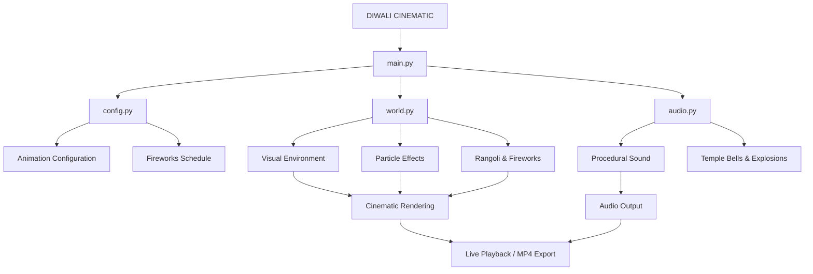

<div align="center">


<br>

# 🪔 HM BHOLA

### PROCEDURAL ANIMATION • CREATIVE ENGINEERING • PYTHON

**A Festival of Lights. An Orchestra of Particles. A World Built Through Code.**

<br>


<br><br>

[**EXPLORE SOURCE CODE**](https://github.com/hmbholamajhi-eng/DIWALI-CINEMATIC-FIREWORKS)
&nbsp; • &nbsp;
[**DEVELOPER PROFILE**](https://github.com/hmbholamajhi-eng)

</div>

---

# Ⅰ. THE VISION

> What happens when mathematics becomes art, particles become fireworks, and programming becomes a celebration?

**DIWALI CINEMATIC** is an experimental procedural animation project that transforms Python code into a cinematic celebration of India's festival of lights.

It combines mathematical geometry, particle simulations, dynamic lighting, procedural audio synthesis and cinematic storytelling into a single animated experience.

This is not a collection of pre-rendered scenes assembled into a video.

The visual world is generated programmatically.

Every flame, particle, explosion, rangoli pattern and sound effect is produced through code.

### THE CORE CONCEPT

| Dimension | Specification |
|:---|:---|
| Project Type | Procedural Cinematic Animation |
| Primary Language | Python |
| Graphics Engine | Pygame |
| Numerical Computing | NumPy |
| Audio | Procedurally Generated |
| Duration | Approximately 60 seconds |
| Resolution | 1080 × 1920 |
| Aspect Ratio | 9:16 |
| Target Frame Rate | 30 FPS |
| Export Format | MP4 |

---

# Ⅱ. THE CINEMATIC UNIVERSE

<div align="center">


</div>

### ACT I — THE AWAKENING

**Darkness → Light**

Silence. Darkness. A single diya.

The first flame illuminates the surrounding environment. Gradually, more diyas awaken, transforming a dark courtyard into a warm, glowing celebration.

**Visual language:** Atmospheric darkness, flame illumination and environmental light propagation.

### ACT II — THE GEOMETRY OF TRADITION

**Mathematics → Mandala**

A spectacular rangoli begins forming from its centre.

More than 100 visual layers expand outward, creating a complex geometric mandala inspired by traditional Indian rangoli.

**Visual language:** Radial geometry, colour transitions and layered particle generation.

### ACT III — THE SKY COMES ALIVE

**Particles → Fireworks**

Rockets rise behind the temple skyline.

The night transforms into a dynamic fireworks spectacle.

| Firework | Visual Character |
|:---|:---|
| Peony | Expanding spherical explosion |
| Ring | Circular particle formation |
| Willow | Falling, trailing sparks |
| Crackle | Irregular particle bursts |
| Heart | Heart-shaped explosion |

**Visual language:** Particle physics, explosion patterns and dynamic illumination.

### ACT IV — THE GOLDEN SIGNATURE

**Celebration → Identity**

The cinematic sequence reaches its climax with a massive golden explosion.

Thousands of visual sparks converge to form:

<div align="center">

# ✨ HAPPY DIWALI ✨

**A celebration written in light.**

</div>

---

# Ⅲ. THE ENGINEERING INSIDE

This project brings together multiple programming and graphics concepts.

### 01 — PROCEDURAL GRAPHICS

- Mathematical visual generation.
- Particle-based animation.
- Dynamic colour variation.
- Multi-layered rangoli generation.
- Procedural fireworks simulation.

### 02 — DYNAMIC ILLUMINATION

- Dynamic light-map system.
- Diya-based lighting.
- Fireworks illumination.
- Glowing temple windows.
- Environmental lighting effects.

### 03 — CINEMATIC CAMERA SYSTEM

- Tilt-up camera movement.
- Pull-back camera movement.
- Camera shake during explosions.
- Cinematic vignette.
- Film grain.
- Bloom and glow effects.

### 04 — PROCEDURAL AUDIO

The soundtrack is generated programmatically.

It includes:

- Temple bells synchronized with diya lighting.
- Atmospheric drone pads.
- Rocket launch whooshes.
- Fireworks explosions.
- Crackling particle effects.
- Golden finale chord.

### 05 — VISUAL IDENTITY

The HM BHOLA watermark appears in the top-left and bottom-right corners throughout the animation.

---

# Ⅳ. SYSTEM ARCHITECTURE

The project is organized into dedicated modules to separate application execution, configuration, visual generation and sound generation.



### PROJECT STRUCTURE

```text
DIWALI-CINEMATIC/
│
└── Diwali_Cinematic_HM_BHOLA/
    │
    ├── main.py
    ├── config.py
    ├── world.py
    ├── audio.py
    ├── requirements.txt
    └── README.md
```

| Module | Engineering Responsibility |
|:---|:---|
| `main.py` | Main execution and application control |
| `config.py` | Animation parameters and configuration |
| `world.py` | Environment, visual elements and animation |
| `audio.py` | Procedural soundtrack and sound generation |
| `requirements.txt` | Dependency management |

---

# Ⅴ. TECHNOLOGY ECOSYSTEM

<div align="center">


<br><br>


</div>

| Technology | Purpose |
|:---|:---|
| Python | Core programming and application logic |
| Pygame | Rendering, animation and graphics |
| NumPy | Numerical operations and mathematical computations |
| imageio-ffmpeg | MP4 video exporting |

---

# Ⅵ. INSTALLATION & DEPLOYMENT

### SYSTEM REQUIREMENTS

- Python 3 installed.
- pip package manager.
- Compatible desktop environment.
- Sufficient processing resources for cinematic rendering.

### STEP 01 — CLONE

```bash
git clone https://github.com/hmbholamajhi-eng/DIWALI-CINEMATIC-FIREWORKS.git
```

### STEP 02 — NAVIGATE

```bash
cd DIWALI-CINEMATIC-FIREWORKS/Diwali_Cinematic_HM_BHOLA
```

### STEP 03 — CREATE VIRTUAL ENVIRONMENT

```bash
python -m venv venv
```

Activate on Windows:

```powershell
venv\Scripts\activate
```

### STEP 04 — INSTALL DEPENDENCIES

```bash
pip install -r requirements.txt
```

Alternatively:

```bash
pip install pygame numpy imageio-ffmpeg
```

> `imageio-ffmpeg` is only required for MP4 exporting.

---

# Ⅶ. EXECUTION & RENDERING

### LIVE CINEMATIC MODE

```bash
python main.py
```

Launch the animation with sound.

### PERFORMANCE MODE

```bash
python main.py --quality low
```

Use lighter visual effects for slower computers.

### CINEMATIC EXPORT MODE

```bash
python main.py --render
```

Generate the complete MP4 cinematic.

### CUSTOM VIDEO EXPORT

```bash
python main.py --render my.mp4
```

### EXPORT SPECIFICATIONS

| Parameter | Value |
|:---|:---|
| Resolution | 1080 × 1920 |
| Aspect Ratio | 9:16 |
| Frame Rate | 30 FPS target |
| Container | MP4 |
| Audio | Included |
| Duration | Approximately 60 seconds |

The renderer targets a consistent 30 FPS output independently of real-time playback speed. Actual export performance depends on hardware.

---

# Ⅷ. CONTROL INTERFACE

| Keyboard | Operation |
|:---:|:---|
| `ESC` | Exit application |
| `SPACE` | Restart animation |
| `F` | Toggle fullscreen |

---

# Ⅸ. CUSTOMIZATION LAB

The project provides configuration and visual modules for modifying its cinematic presentation.

### CONFIGURATION — `config.py`

| Variable / Function | Purpose |
|:---|:---|
| `BRAND` | Branding and footer text |
| `T_TEXT` | Finale timing |
| `make_fireworks()` | Fireworks schedule, positions, types and colours |

### VISUAL GENERATION — `world.py`

Customize the final title:

- `HAPPY`
- `DIWALI`
- Subtitle

Modify the project's configuration and visual elements to create a different presentation.

---

# Ⅹ. PERFORMANCE & OPTIMIZATION

The project provides two primary execution modes.

| Mode | Intended Use |
|:---|:---|
| Normal | Full real-time cinematic experience |
| Low Quality | Lighter playback on slower computers |
| Render | MP4 video generation |

For the best cinematic export experience:

```bash
python main.py --render
```

For lighter real-time playback:

```bash
python main.py --quality low
```

---

# Ⅺ. VISUAL SHOWCASE

<div align="center">

**THE WORLD OF DIWALI CINEMATIC**

</div>

<!--
After capturing actual screenshots from your project, add them here.

Suggested assets:
assets/diya-scene.png
assets/rangoli-scene.png
assets/fireworks-scene.png
assets/finale-scene.png
assets/diwali-preview.gif

Example:

-->

To make this section truly impressive, add a short GIF showing the transition from the first diya to the golden finale.

A real project preview is much more valuable than decorative stock images.

---

# Ⅻ. ENGINEERING PHILOSOPHY

**Not everything needs a pre-made asset. Sometimes the best asset is an algorithm.**

DIWALI CINEMATIC explores the creative potential of combining:

- Mathematical geometry.
- Procedural visual generation.
- Particle simulations.
- Dynamic illumination.
- Audio synthesis.
- Cinematic storytelling.

The central idea is to transform programming logic into an artistic experience.

This project represents an exploration of Python beyond conventional application development.

---

# XIII. AUTHOR & CREATOR

<div align="center">


### HM BHOLA

**Python Developer · Creative Technology Enthusiast**

Building ideas through logic, mathematics, programming and imagination.

<br>

<a href="https://github.com/hmbholamajhi-eng">

</a>

</div>

---

# XIV. PROJECT CLOSING

<div align="center">

## 🪔 LET THERE BE LIGHT.

## LET THERE BE CODE.

### HAPPY DIWALI!

**Made with ❤️, Python, Mathematics & Imagination.**

<br>


**DIWALI CINEMATIC · AN INDEPENDENT PROJECT BY HM BHOLA**

© HM BHOLA

</div>

---

<div align="center">

*Code is the medium. Mathematics is the language. Imagination is the limit.*

</div>
